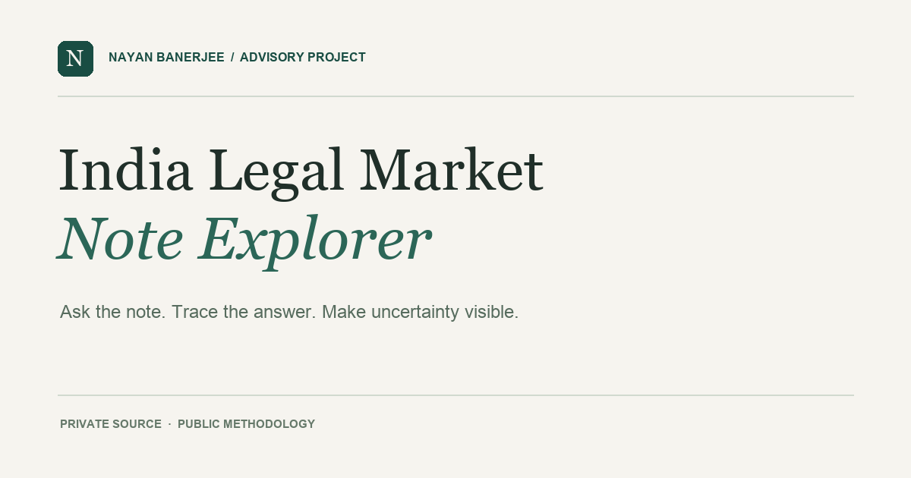

# India Legal Market Note Explorer

**[Visit the project site](https://nayanban.github.io/indianlegaltech/)** · **[Read how I built it](HOW_IT_WAS_BUILT.md)**



I prepared an India legal market note as an advisor for a company. This project turns the private note into a question-led interface: authorized readers can ask in their own words, inspect the passages behind an answer, see what the note cannot establish, and identify what to research next.

**Current status:** The GitHub Pages interface and encrypted note are published. The AI answer service is not connected yet, so the private explorer is unavailable. GPT-6 Luna has been selected for a later, small prepaid pilot; no API key is configured in this repository.

## Why this exists

An advisory note can contain useful context while leaving some questions open. A quick answer is only useful if the reader can see its basis and distinguish what the note says from what still needs verification.

I authored the source note and defined the product requirements: free-form questions, visible source passages, explicit uncertainty, and concrete follow-up research questions. I used AI-assisted development to implement and test the interface and answer service. The [build account](HOW_IT_WAS_BUILT.md) explains the decisions and their limits.

## Intended reader experience

1. An authorized reader enters the shared passphrase and asks a question in their own words.
2. The service selects a bounded set of likely relevant passages and sends them with the question to an AI model.
3. The answer distinguishes supported, partial, and unsupported responses. It shows cited passages, limitations, and research questions where needed.

This is not a fixed FAQ. Citation IDs are checked against the passages actually sent to the model, but readers should still inspect whether the passages support the answer. The interface describes the note; it does not independently verify current market claims or provide legal advice. There is no public demonstration of the private note or its answers.

## Architecture

```text
GitHub Pages (public interface + encrypted note)
        │ question + shared passphrase
        ▼
Sites serverless API (decrypts note and selects passages in memory; keeps API key private)
        │ question + selected passages (no passphrase)
        ▼
OpenAI Responses API
        │ structured answer
        ▼
The API checks citation IDs and returns cited passages, limitations, and research questions
```

The repository contains `public/note.enc.json`, an AES-256-GCM encrypted copy of the note. It does not contain the plaintext note, the passphrase, or the OpenAI API key. The passphrase is shared separately with authorized readers. Anyone with it can read the note and use the answer service; this design does not provide individual accounts or revocation.

The opening preliminary analysis is tagged separately from the later market notes. Answers distinguish hypotheses from observations and never present the note as independent verification of current facts or legal advice.

## Repository layout

| Path | Purpose |
| --- | --- |
| `public/` | Static GitHub Pages interface and encrypted note |
| `worker/worker.mjs` | Serverless answer API, deployed through Sites |
| `.openai/hosting.json` | Sites project identity and deployment configuration |
| `scripts/extract_docx.py` | Extracts paragraphs from the source DOCX into an ignored private JSON file |
| `scripts/encrypt.mjs` | Encrypts that private JSON for publication |
| `scripts/verify-private.mjs` | Confirms the encrypted file matches the private source |
| `tests/` | Tests for decryption, access checks, and evidence validation |
| `HOW_IT_WAS_BUILT.md` | Product and implementation case study |

## Deployment

1. Enable GitHub Pages for this repository with **GitHub Actions** as its source. `.github/workflows/pages.yml` publishes `public/` on pushes to `main`.
2. Build the Sites API with `npm run build:sites-api`. The Sites project ID is in `.openai/hosting.json`; its source is `worker/worker.mjs`. When activating answers, set its runtime environment values to `ALLOWED_ORIGIN=https://nayanban.github.io`, `NOTE_URL=https://nayanban.github.io/indianlegaltech/note.enc.json`, and `OPENAI_MODEL=gpt-6-luna`.
3. Configure the Sites runtime secret `OPENAI_API_KEY` through the OpenAI Developers integration. Never add it to this repository or `public/config.js`. Publish the Sites API and allow visitors with the public URL to reach it; the shared passphrase still controls access to the note.
4. Put the deployed Sites API URL in `public/config.js` as `apiBaseUrl`, then push that change so GitHub Pages receives it.
5. Give the passphrase to authorized readers through a separate channel. It is not stored in the site, browser storage, or the repository.

The service needs an OpenAI API account with billing enabled. Model usage incurs a charge per question. Set an API spend limit and, if traffic grows, add API rate limiting. GitHub Pages hosts the static interface without an application server. The answer service remains unconnected while the API setup is tabled.

## Updating the note

Use the source DOCX only on a trusted computer:

```sh
python3 scripts/extract_docx.py /path/to/source.docx private/source.json
node scripts/encrypt.mjs "$PWD/private/source.json" public/note.enc.json < private/access.key
node scripts/verify-private.mjs
node --test
```

Only commit the changed `public/note.enc.json`. `private/` is ignored by Git. To revoke a shared passphrase, generate a new strong random passphrase, re-encrypt the note, and distribute the new one.

## Limits

- The note is decrypted in the Sites API for each authorized question. Only selected passages and the question are sent to OpenAI for that answer. The passphrase is **not** sent to OpenAI. The request sets `store: false`; see [OpenAI's API data controls](https://developers.openai.com/api/docs/guides/your-data) for applicable retention details.
- Passage selection uses keyword matching. It may miss relevant sections when a viewer uses different terminology; answers say that other passages may not have been selected. A viewer can rephrase the question or inspect the original note if certainty matters.
- Answers are restricted to the source note. They do not search the web or confirm whether time-sensitive claims remain true.
- The API checks that citation IDs exist, but a reader should still inspect the quoted passages to decide whether they support the answer.
- A shared passphrase cannot identify individual viewers. If individual access control becomes necessary, add authenticated accounts and move the note behind that service.

Copyright (c) 2026 Nayan Banerjee. All rights reserved.
